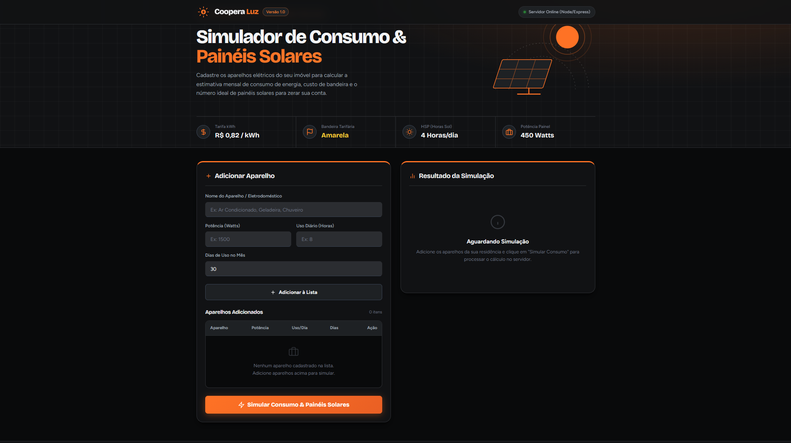

# Medidor Coopera - Calculadora de Consumo & Dimensionamento Solar

> Aplicação web desenvolvida em Node.js e Express para simulação de consumo elétrico residencial, estimativa de custos com tarifas/bandeiras tarifárias e dimensionamento de painéis fotovoltaicos.

[](https://medidor-coopera.onrender.com/)

---

## 📸 Demonstração do Projeto

<div align="center">
  
</div>

---

##  Funcionalidades

-  **Cadastro Dinâmico de Aparelhos:** Adição de eletrodomésticos informando potência (W), horas de uso diário e dias no mês.
-  **Cálculo de Consumo Mensal:** Conversão automática dos dados de uso individual e total para kWh/mês.
-  **Aplicação de Tarifas & Bandeiras:** Cálculo de custo financeiro considerando a tarifa base regional (ex: R$ 0,82/kWh) e o adicional proporcional das bandeiras tarifárias da ANEEL (Bandeira Amarela, Vermelha, etc.).
-  **Dimensionamento Fotovoltaico:** Estimativa exata da quantidade de painéis solares necessários para suprir 100% da demanda energética com base na média de HSP (Horas de Sol Pleno) e eficiência do sistema.
-  **Detalhamento Individual:** Tabela comparativa destacando o consumo em kWh, o impacto em Reais e a porcentagem (%) de cada aparelho no custo total da conta de luz.
-  **Aparelho de Maior Impacto:** Destaque automático do eletrodoméstico que mais consome no imóvel.

---

##  Tecnologias Utilizadas


---

##  Fórmulas Utilizadas

### 1. Consumo Individual (kWh)
$$\text{kWh/mês} = \frac{\text{Potência (W)} \times \text{Horas/dia} \times \text{Dias/mês}}{1000}$$

### 2. Geração por Painel Solar
$$\text{Geração por Painel} = \frac{\text{Potência Painel (W)} \times \text{HSP} \times 30 \times \text{Eficiência}}{1000}$$

### 3. Painéis Necessários
$$\text{Painéis} = \left\lceil \frac{\text{Consumo Total (kWh)}}{\text{Geração por Painel (kWh)}} \right\rceil$$

---

##  Como Executar o Projeto Localmente

### Pré-requisitos
- [Node.js](https://nodejs.org/) instalado na máquina.

### Passo a Passo

1. **Clonar o repositório:**
   ```bash
   git clone [https://github.com/SEU_USUARIO/SEU_REPOSITORIO.git](https://github.com/SEU_USUARIO/SEU_REPOSITORIO.git)
